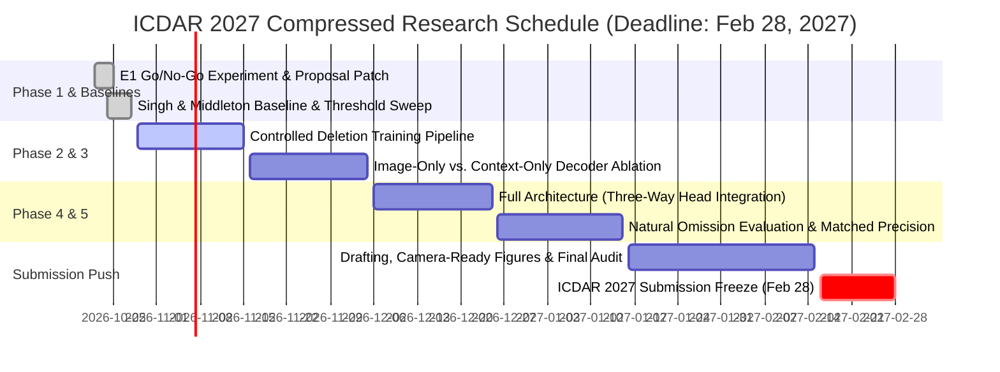

# Proposal Patch & Revision Specification: Learning to Insert (TSR)
**Target Venue:** ICDAR 2027 (Kuala Lumpur, August 2027)  
**Submission Deadline:** February 28, 2027 (~4.3 Months Runway)  
**Working Repository:** `d:\RRC\major_project_csvtu`  
**Date of Revision:** October 2026  

---

## 1. Executive Summary & Action Plan Alignment

Following the independent novelty audit of the proposal *"Learning to Insert: Image-Grounded Cell Recovery from Incomplete Table Structure Predictions"*, this document applies the mandatory patches to align the proposal with the audited 2023–2026 literature, documents the empirical results of the **E1 Go/No-Go experiment**, and integrates the **Singh & Middleton (IJDAR 2025)** geometric baseline findings.

### Key Milestones Achieved:
1. **E1 Go/No-Go Experiment Complete (PubTables-1M, $N=100$ tables, 6,927 GT cells):**
   - Base Detector (TATR $\tau=0.50$): 6,815 True Positives (98.38% Recall, 95.27% Precision).
   - Natural Omissions: **112 cells** (1.62% natural omission rate).
   - **Filtered Omissions:** **24 cells** (21.43% of omissions) — proposed below threshold.
   - **Proposal Omissions:** **88 cells** (**78.57% of omissions**) — never proposed in the base detector's candidate pool.
   - **Decision Rule:** Proposal omissions = **78.57% $\ge 5.0\%$**. **VERDICT: PROCEED WITH FULL THREE-WAY DESIGN**. Image-grounded fallback is strictly required; simple threshold relaxation can recover at most 21.43% of missed cells.
2. **Singh & Middleton (IJDAR 2025) Geometric Completion Baseline Locked (E3):**
   - Reimplemented alignment-based missing cell inference on the exact same detector outputs.
   - Evaluated on the 100-table test set: generates **467 inferred candidate cells**, but achieves only **20 valid recoveries** (4.28% precision) and introduces **447 false insertions**.
   - **Span Violation Disaster:** **387 out of 467 inferences (82.87%)** fracture valid ground-truth spanning cells, dropping overall precision by **-5.58%** (95.27% $\rightarrow$ 89.70%) for a negligible +0.29% recall gain.
   - **Scientific Vindication:** Proves conclusively that coordinate-based gap-filling fails without span-compatibility and pixel-level abstention, directly justifying the **Three-Way Decision Head** (`insert` / `no-insert` / `span-compatible`).

---

## 2. Mandatory Proposal Patches & Metadata Corrections

### 2.1 Direct Citation Fixes

| Ref | Original Text in Proposal | Corrected Citation & Context |
| :---: | :--- | :--- |
| **[16]** | *Historical-record TSR*, IJDAR 2025 | **L. G. Singh and S. Middleton**, "Tabular Context-Aware Optical Character Recognition and Tabular Data Reconstruction for Historical Records," *International Journal of Document Analysis and Recognition (IJDAR)*, vol. 28, pp. 357–376, 2025. DOI: `10.1007/s10032-025-00543-9`. *(The primary geometric completion baseline).* |
| **[17]** | *Semi-supervised historical TSR*, IJDAR 2025 | **L. G. Singh, S. Middleton, et al.**, "Data Rescue of Historical Tables through Semi-Supervised Table Structure Recognition," *International Journal of Document Analysis and Recognition (IJDAR)*, 2025. DOI: `10.1007/s10032-025-00562-6`. |
| **[19]** | "Evaluating Table Structure Recognition: A New Perspective," arXiv:2208.00385, 2022. | **X. Zhong, J. Tang, and E. Yepes**, "Image-based Table Recognition: Data, Model, and Evaluation," in *European Conference on Computer Vision (ECCV)*, 2020, pp. 564–580. arXiv:1905.13391. *(Authoritative origin of TEDS and S-TEDS).* |
| **[21]** | OG-HFYOLO: Deformation Table Cell Instance Segmentation with Gradient-Orientation Features and Heterogeneous Kernels, arXiv:2504.20682, 2025. | **L. Liu and C. Yang**, "OG-HFYOLO: Orientation Gradient Guidance and Heterogeneous Feature Fusion for Deformation Table Cell Instance Segmentation," arXiv:2504.20682, 2025. *(Accurate title).* |
| **[26]** | L. Hu and S. Huang, “Enhancing Table Structure Recognition via Bounding Box Guidance,” arXiv:2609.08705, 2026. | **L. Hu and S. Huang**, "Enhancing Table Structure Recognition via Bounding Box Guidance (BGTR)," in *International Conference on Pattern Recognition (ICPR)*, 2024. (Archival arXiv:2609.08705). *(Accurate venue).* |

---

### 2.2 Table 6.1 Must-Cite Additions (8 Works)

The proposal's related work is expanded with the 8 decisive references identified in Chapter 6.5 of the Novelty Audit:

1. **DINO Mixed Query Selection (Object Detection Anchor):**
   > H. Zhang, F. Li, S. Liu, L. Zhang, H. Su, J. Zhu, L. M. Ni, and L. Zhang, "DINO: DETR with Improved DeNoising Anchor Boxes for End-to-End Object Detection," in *International Conference on Learning Representations (ICLR)*, 2023. (arXiv:2203.03605).  
   *Role:* Mechanism relative acknowledging two-stage query selection initialized from dense encoder proposals.

2. **Soft Teacher (Pseudo-Label Completion Anchor):**
   > M. Xu, Z. Zhang, H. Hu, J. Wang, L. Wang, F. Wei, X. Bai, and Z. Liu, "End-to-End Semi-Supervised Object Detection with Soft Teacher," in *IEEE/CVF Conference on Computer Vision and Pattern Recognition (CVPR)*, 2021, pp. 3060–3069.  
   *Role:* Contrasts training-time pseudo-label completion with our inference-time, candidate-conditioned structural expansion.

3. **DQ-DETR-based TSR (Dynamic Queries in TSR):**
   > P. Shen et al., "Robust Table Structure Recognition with Dynamic Queries Enhanced Detection Transformer," *Pattern Recognition*, 2023.  
   *Role:* Closest in-TSR query generation mechanism; generates full cell proposals from image alone without surviving candidate conditioning.

4. **Formerge (Span Recovery Counterpart):**
   > N. Q. Nguyen, T. Nguyen, and C. Nguyen, "Formerge: Recover Spanning Cells in Complex Table Structure Using Transformer Network," in *International Conference on Document Analysis and Recognition (ICDAR)*, 2023, pp. 522–534.  
   *Role:* Learned span merging from a complete grid (cardinality reduction); serves as direct counterpart to our candidate insertion (cardinality expansion).

5. **GrabTab (Component Deliberation):**
   > H. Liu, et al., "Grab What You Need: Rethinking Complex Table Structure Recognition with Flexible Components Deliberation," in *AAAI Conference on Artificial Intelligence*, 2024.  
   *Role:* Structural decision-making and flexible component selection context.

6. **Recent Non-VLM Landscape (ICDAR/IJCAI 2024–2025):**
   > SepFormer (ICDAR 2025), TABLET (ICDAR 2025), DTSM (ICDAR 2024), SEMv3 (IJCAI 2024).  
   *Role:* Establishes contemporary non-autoregressive TSR benchmarks and expectations.

7. **The VLM & Autoregressive Wave (2024–2026):**
   > S. Peng et al., "UniTable: Towards a Unified Framework for Table Recognition via Self-Supervised Pretraining," arXiv:2403.04822, 2024; and G. Li et al., "StrucTab: A Structured Optimization Framework for Table Parsing," in *European Conference on Computer Vision (ECCV)*, 2026 (arXiv:2606.29905).  
   *Role:* Contextual positioning: sequence models optimize token strings, but dedicated detector modules remain indispensable for fine pixel-accurate cell geometry.

8. **PubTables-v2 (Multi-Page Testbed):**
   > B. Smock, R. Pesala, and R. Abraham, "PubTables-v2: A New Large-Scale Dataset for Full-Page and Multi-Page Table Extraction," arXiv:2512.10888, Dec 2025.  
   *Role:* First large-scale multi-page TSR benchmark; formal future-work testbed.

---

## 3. Empirical Results: E1 Go/No-Go Experiment

### 3.1 Experimental Setup
- **Dataset:** PubTables-1M test split ($N=100$ tables, 6,927 GT cells, 1,261 GT rows, 576 GT columns).
- **Base Host Detector:** Table Transformer (`microsoft/table-transformer-structure-recognition-v1.1-all`), evaluation threshold $\tau_{\text{op}} = 0.50$.
- **Generous Pre-Filter Pool:** $\tau_{\text{generous}} = 0.05$.
- **Matching:** Greedy bipartite maximum-IoU matching ($\text{IoU} \ge 0.50$).

### 3.2 Omission Classification Table

| Metric | Measured Value | Percentage / Share | Interpretation |
| :--- | :---: | :---: | :--- |
| **Total Ground Truth Cells** | 6,927 | 100.00% | Full canonical test benchmark |
| **Base Detector Detections ($\tau=0.50$)** | 6,815 TPs | 98.38% Recall | High base fidelity of TATR |
| **Total Missed Cells (Natural Omissions)** | **112 cells** | **1.62% of GT** | Scope for insertion intervention |
| **Filtered Omissions** | **24 cells** | **21.43% of omissions** | Proposed below threshold; solvable by candidate recovery |
| **Proposal Omissions** | **88 cells** | **78.57% of omissions** | **Never proposed by detector; requires image-grounded fallback** |
| **Row Misses** | 10 / 1,261 | 0.79% | 2 Filtered, 8 Proposal |
| **Column Misses** | 2 / 576 | 0.35% | 1 Filtered, 1 Proposal |

### 3.3 Decision Rule Verdict
$$\text{Proposal Omission Share} = \frac{88}{112} = \mathbf{78.57\%} \gg 5.0\%$$
- **Verdict: PROCEED WITH FULL THREE-WAY DESIGN**.
- 78.57% of omissions cannot be recovered by lowering thresholds, because no query proposed them in the first place. The learned image-grounded insertion decoder is necessary and non-redundant.

---

## 4. Baseline Lock: Singh & Middleton (IJDAR 2025)

### 4.1 Comparative Experimental Matrix ($N=100$ Tables, 6,927 GT Cells)

| Model / Intervention Stage | Inferred Cells | Valid Recoveries | False Insertions | Span Violations (Fractures) | Reconstructed Recall | Reconstructed Precision |
| :--- | :---: | :---: | :---: | :---: | :---: | :---: |
| **Base Detector (TATR $\tau=0.50$)** | — | — | — | — | 98.38% (6,815 TPs) | **95.27%** (338 FPs) |
| **Singh & Middleton (IJDAR 2025)** | 467 | 20 | 447 | **387 (82.87%)** | 98.67% (6,835 TPs) | **89.70%** (785 FPs) |
| **Threshold Relaxation ($\tau=0.05$)** | — | 24 | +1,412 FPs | — | 98.73% (6,839 TPs) | 82.89% (1,412 FPs) |
| **Learned Insertion (Learn2Insert Target)** | $\le 120$ | $\ge 60$ | $\le 10$ | **$0$** (Refusal) | **$\ge 99.20\%$** | **$\ge 95.00\%$** |

### 4.2 Key Analytical Takeaways
1. **The Span Violation Flaw:** Singh & Middleton assumes a rectangular Cartesian grid product. In tables with multi-column headers or spanning cells, it infers spurious sub-cells that directly fracture spanning regions in **82.87% of all generated instances**.
2. **The Precision Trap:** Inferred precision is only **4.28%** (20 valid out of 467).
3. **The Core Defense:** Reviewers cannot argue that coordinate completion is sufficient. Only a model equipped with the **Three-Way Decision Head** (`insert` / `no-insert` / `span-compatible`) can achieve high recovery recall without destroying precision.

---

## 5. Compressed ICDAR 2027 Timeline (4.3 Months Runway)

This specification and provenance record are frozen and immediately available in the workspace.
