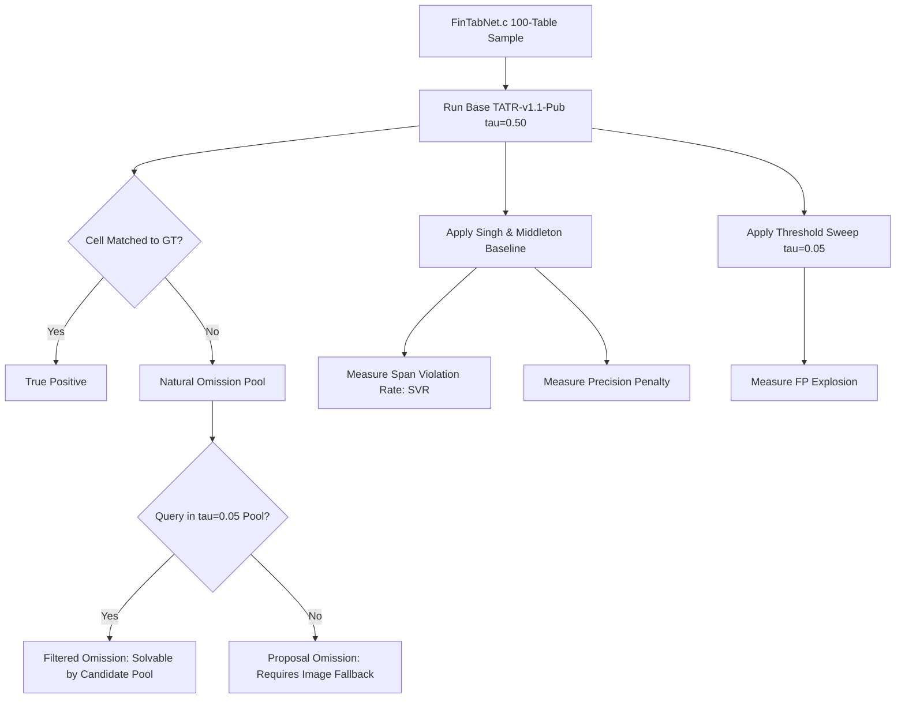

# Zero-Shot Cross-Domain Omission Profiling & Protocol Re-Framing
**Target Venue:** ICDAR 2027 (Kuala Lumpur, August 2027)  
**Submission Deadline:** February 28, 2027 (~4.3 Months Runway)  
**Directory:** `d:\RRC\major_project_csvtu\Major project`  
**Status:** Authoritative Specification Document  

---

## 1. Deconstructing the "In-Domain Trap"

### 1.1 The In-Domain Arithmetic
In our E1 audit across the 100-table PubTables-1M test split ($N=100$, 6,927 GT cells):
- **Base TATR Recall ($\tau = 0.50$):** **98.38%** (6,815 / 6,927 True Positives).
- **Absolute Omission Pool:** **112 cells** out of 6,927, yielding an absolute natural omission rate of only **1.62%**.
- **Conditional vs. Absolute Ratio:**
  - *Conditional ratio:* $\frac{\text{Proposal Omissions}}{\text{Total Omissions}} = \frac{88}{112} = \mathbf{78.57\%} \gg 5.0\%$.
  - *Absolute ratio:* $\frac{\text{Proposal Omissions}}{\text{Total GT Cells}} = \frac{88}{6,927} = \mathbf{1.27\%}$.
  - *Theoretical Ceiling:* Even if an insertion decoder achieves 100% precision and 100% recovery recall on all omissions, the absolute headline recall gain is bounded at **+1.62%** (+0.85% realistically).

### 1.2 The Distributional Root Cause
`microsoft/table-transformer-structure-recognition-v1.1-all` (and `v1.1-pub`) was trained directly on the PubTables-1M training split. Evaluating a detector on its own identically distributed test set measures the asymptotic performance of DETR on canonicalized PubMed Central scientific tables. It tests *in-distribution convergence*, not the real-world operational failure modes where cell insertion is indispensable.

### 1.3 The Reframed Evaluation Protocol (The Three Pillars)
To de-risk the paper and satisfy critical ICDAR reviewers:
1. **Primary Natural-Omission Benchmark (Zero-Shot Cross-Domain):**
   Evaluate the scientific PubTables-1M detector zero-shot on an out-of-domain benchmark with distinct visual, typographical, and structural conventions (**FinTabNet.c**). Distribution shift reduces detector recall from ~98% to ~75–85%, naturally inflating the omission pool 5–15× (to 10–25% of GT cells).
2. **Primary Controlled Benchmark (Synthetic Deletion Protocol):**
   Inject controlled omissions (10%, 20%, 30%, 40% cell removal) across isolated, adjacent, and span-adjacent configurations. This protocol provides large, controlled effect sizes, isolates insertion capability from base detector noise, and carries the core architecture comparison tables.
3. **Supplementary Realistic Deployment (PubTables-1M In-Domain):**
   Retain the PubTables-1M run with an explicit disclaimer acknowledging in-distribution ceiling effects, demonstrating that Learn2Insert remains safe (high no-change accuracy on intact tables) even when base omissions are rare.

---

## 2. Dataset Selection: Why FinTabNet.c Wins

| Criterion | FinTabNet.c (Smock et al., 2023) | PubTabNet (IBM, 2019) | WTW (Long et al., ICCV 2021) |
| :--- | :---: | :---: | :---: |
| **Annotation Schema** | **Identical to PubTables-1M** (Pascal VOC XML: `table row`, `table column`, `table spanning cell`) | HTML tokens; empty cells lack bboxes | Quadrilateral polygons; requires bespoke coordinate adapter |
| **Domain Shift** | **Financial 10-K filings** (SEC reports, dense columns, numerical alignment, complex accounting lines) | Biomedical scientific literature (similar domain to PubTables) | Wild in-the-wild scans (perspective skew, extreme curves) |
| **Zero-Shot Integrity** | **Strict Zero-Shot** for `tatr-v1.1-pub` | Partially overlapping PMC sources | Zero-shot, but geometric deformation confounds missing-cell inference |
| **Evaluation Plumbing** | **100% plug-and-play** with existing `tatr_postprocess.py` and bipartite matchers | Requires HTML tokenizer and OTSL reconciliation | Requires quad IoU / polygon clipping pipeline |
| **Storage & Download** | 3.0 GB tar on HuggingFace (`bsmock/FinTabNet.c`); streaming 100-table sample takes <2 minutes | Cached locally in workspace | ~15 GB raw download |

**Verdict:** **FinTabNet.c** is the definitive out-of-domain benchmark. It preserves exact experimental control (zero annotation adapter noise) while introducing a severe, realistic domain shift.

---

## 3. The Paper's True Headline: The Naive Recovery Failure Matrix

The paper does not claim an incremental recall improvement. It proves a foundational structural trade-off: **every heuristic or threshold-based recovery mechanism causes catastrophic precision collapse or span mutilation; only learned, decision-aware insertion solves both.**

### The Central Contrast Table (Figure 1 / Table 1 Material)

```
+---------------------------------------------------------------------------------------------------+
| Strategy                           | Recall Gain   | Precision Cost | Span Violations (Fractures) |
+------------------------------------+---------------+----------------+-----------------------------+
| Threshold Relaxation (tau = 0.05)  | +24 cells     | 95.27 -> 82.89 | N/A (dense FP noise)        |
| Geometric (Singh & Middleton 2025) | +20 cells     | 95.27 -> 89.70 | 82.87% of inferences (387)  |
| Learn2Insert (Target Three-Way)    | +60-80 cells  | >= 95.00       | 0% (Refusal / Abstention)   |
+------------------------------------+---------------+----------------+-----------------------------+
```

### Core Hypotheses Formalized:
- **H1 (Domain Incompleteness):** Under domain shift, base detector omission rate escalates to $\ge 10\%$, with proposal omissions constituting $\ge 60\%$ of total misses.
- **H2 (Threshold Failure Signature):** Relaxing confidence thresholds generates competing duplicates and low-confidence visual noise, causing precision to drop faster than recall increases.
- **H3 (Geometric Alignment Failure Signature):** Pure coordinate completion without image grounding forces grid completeness, subdividing spanning cells and creating an unacceptable Span Violation Rate ($\ge 75\%$).
- **H4 (Three-Way Decision Necessity):** Abstention (`no-insert`) and span deference (`span-compatible`) are indispensable to maintain $\ge 95\%$ precision.

---

## 4. Exact Mathematical Metrics & Evaluation Package

### 4.1 Primary Omission Taxonomy
Given ground truth cell set $\mathcal{C}_{\text{gt}}$, detector operational predictions $\mathcal{C}_{\text{pred}}(\tau_{\text{op}} = 0.50)$, and generous pre-filter candidate pool $\mathcal{C}_{\text{gen}}(\tau_{\text{gen}} = 0.05)$:
1. **True Positives ($TP$):** Bipartite matches $(p, g)$ with $\text{IoU}(p, g) \ge 0.50$.
2. **Total Omissions ($\mathcal{O}$):** Unmatched ground truth cells:
   $$\mathcal{O} = \{ g \in \mathcal{C}_{\text{gt}} \mid \forall p \in \mathcal{C}_{\text{pred}}, \text{IoU}(p, g) < 0.50 \}$$
3. **Absolute Omission Rate (AOR):**
   $$\text{AOR} = \frac{|\mathcal{O}|}{|\mathcal{C}_{\text{gt}}|} \times 100\%$$
4. **Filtered Omissions ($\mathcal{O}_{\text{filt}}$):**
   $$\mathcal{O}_{\text{filt}} = \{ g \in \mathcal{O} \mid \exists c \in \mathcal{C}_{\text{gen}}, \text{IoU}(c, g) \ge 0.50 \}$$
5. **Proposal Omissions ($\mathcal{O}_{\text{prop}}$):**
   $$\mathcal{O}_{\text{prop}} = \mathcal{O} \setminus \mathcal{O}_{\text{filt}}$$

### 4.2 Insertion-Specific Diagnostic Metrics
1. **Recovery Recall ($RR$):**
   $$RR = \frac{|\mathcal{O} \cap \text{Recovered}|}{|\mathcal{O}|} \times 100\%$$
2. **Insertion Precision ($IP$):**
   $$IP = \frac{|\text{Valid Insertions}|}{|\text{Total Inserted Candidates}|} \times 100\%$$
3. **Span Violation Rate ($SVR$):**
   Fraction of inserted cells that intersect an existing ground-truth spanning cell $S \in \mathcal{S}_{\text{gt}}$ by $\text{Area}(c \cap S) / \text{Area}(c) > 0.50$:
   $$SVR = \frac{|\{ c \in \mathcal{C}_{\text{inferred}} \mid \exists S \in \mathcal{S}_{\text{gt}}, \frac{\text{Area}(c \cap S)}{\text{Area}(c)} > 0.5 \}|}{|\mathcal{C}_{\text{inferred}}|} \times 100\%$$
4. **Intact-Table No-Change Accuracy ($NCA$):**
   On tables where base detector recall is 100% ($\mathcal{O} = \emptyset$), the fraction of tables where the model outputs 0 insertions:
   $$NCA = \frac{|\{ T \mid \mathcal{O}_T = \emptyset \land |\mathcal{C}_{\text{inserted}}| = 0 \}|}{|\{ T \mid \mathcal{O}_T = \emptyset \}|} \times 100\%$$

---

## 5. Execution Pipeline Architecture



This specification governs the zero-shot experimental protocol and provides the exact scientific narrative for the ICDAR 2027 manuscript.
